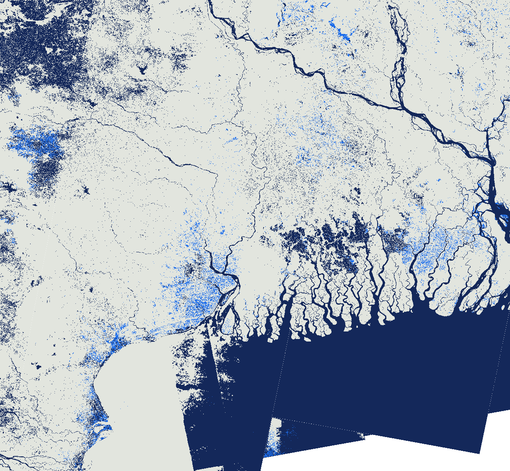

# Flood Model v1: cyclone flood maps from Sentinel-1 radar

Final release, 21 Nov 2026. Built and tested on Cyclone Amphan (landfall 20 May 2020, West Bengal and Bangladesh).



## Get it

The models (`*.pt`) and the big GeoTIFFs (`*.tif`) are stored with [Git LFS](https://git-lfs.com). Install it once, then clone:

```
git lfs install
git clone https://github.com/rishiraj-byte/amphan-flood-model.git
```

Without Git LFS you get small pointer files instead of the models, and `predict.py` will not run.

## Repository layout

| Folder | What is in it |
|---|---|
| `/` (top) | `predict.py` and the `run_*` scripts: the ready-to-run Flood Model v1 |
| `models/` | The 2 flood networks and the early-warning network, each with a model card (`.json`) |
| `results_amphan_2020/` | The verified Amphan output: GeoTIFFs, PNG maps, `summary.json`, `eval.json` |
| `training/` | `train.py` (the training recipe), `kit_utils.py`, `to_geotiff.py` |
| `ops/` | The Flood Ops console (`ops_dashboard.py` + `ops_console.html`), validation tuning (`improve_eval.py`), the training queue and research loop, `build_final.py` |
| `docs/` | The 12-page handbook PDF, the training log, and one report per data kit |

The training data kits (Sentinel-1 radar stacks and label maps, several GB) are not in this repo.

## What it does

One run gives two maps:

1. **Flood map after the storm** (the main product). Every cell of about 100 m becomes dry, flood or permanent water, with a flood chance from 0 to 1. Needs Sentinel-1 radar from before and after landfall.
2. **Early-warning risk map before landfall.** It ranks land by flood risk from pre-storm radar plus the storm track. It is weak: use it to decide where to look first, not to decide.

## How good it is

Scored on Amphan's 134 held-out test blocks. The model never trained on these blocks.

| Check | Score | In plain words |
|---|---|---|
| **Independent NASA ARIA flood map** (the honest check) | IoU **0.344**, precision 0.635, recall 0.429 | Of every 10 cells it calls flood, about 6 are flood in ARIA. It finds about 4 of every 10 ARIA flood cells. |
| Published Mondal flood map (the training-label source, so optimistic) | IoU 0.511, precision 0.639, recall 0.718 | Finds about 7 of every 10 flood cells of the map it learned from. |
| Simple threshold rule (Otsu), no learning | IoU 0.293 on the published map | The model beats it: 0.511 against 0.293 on the same map. |
| Early warning | PR-AUC 0.267 (random guessing: 0.034) | The 10 % riskiest land holds 53.6 % of the flood that came. |

IoU = flood cells both agree on / flood cells either one marks. 1.0 would be a perfect match.

**Amphan result:** 4,700 km² of flood at the final cutoff of 0.30 (2,504 km² at a strict 0.70), out of 242,591 km² of radar coverage.

## What is inside

- **Two U-Net networks, averaged:** `detect_v3_ops70` and `detect_v4_plus70`, 17.5 M parameters each. Both were trained on the train and validation blocks of Amphan, with labels from the published Mondal map (Zenodo 4390084).
- **Eight views per tile:** every 512 × 512 tile is read 8 times (flipped and turned) and the answers are averaged.
- **Cutoff 0.30:** a cell is flood when its chance is at least 0.30. The cutoff was chosen on validation blocks, never on the test blocks.
- **Early warning:** `risk_v4_plus` (7.8 M parameters), from 9 layers of pre-landfall radar plus the storm track.
- **Input layers (16):** `b_vv b_vh a_vv a_vh d_vv d_vh b_vv_tex a_vv_tex a_inc pre_med_vh pre_min_vh pre_count b_ratio a_ratio d_ratio valid`. None is tied to an Amphan date, so the model can run on any storm.

## Run it

1. **Windows** (the laptop): `run_flood_model.bat STACK_FOLDER OUTPUT_FOLDER`. Add `--cpu` if there is no NVIDIA GPU. Amphan takes about 2 minutes on the RTX 3050.
2. **Re-make the Amphan map:** `run_amphan.bat`.
3. **Linux** (the PC): `./run_flood_model.sh STACK_FOLDER OUTPUT_FOLDER`.
4. **Point and click:** the Flood Ops console, Control page.

The settings are built in: both models, 8 views, cutoff 0.30. `python predict.py --help` lists the options.

## Input: a radar stack folder

- `meta.json`: the grid (west, north, cell size, width, height) and the layer names.
- `inputs_detect.npy`: the 16 layers above, after the storm.
- `inputs_forecast.npy`: 9 layers, before landfall plus the storm track.

The PC's `build_stack.py` makes this folder for any storm (kit v4 layout). If the folder also holds reference flood maps (`ref_labels.npy`, `ref2_labels.npy`) and `split.npy`, the model scores itself.

## Output

| File | What it is |
|---|---|
| `flood_class.tif` | 0 dry, 1 flood, 2 permanent water, 255 no radar. Opens in QGIS / ArcGIS |
| `flood_probability.tif` | Flood chance, 0 to 1 |
| `flood_risk.tif` | Early-warning risk, 0 to 1 (a ranking) |
| `flood_map.png`, `risk_map.png` | Quick-look pictures |
| `summary.json` | Flood km², water km², risk zones |
| `eval.json` | Scores, only when reference maps are present |

`results_amphan_2020/` holds the verified Amphan output, including `preview_flood_over_radar.png`.

## Limits: read before using

- **One storm.** Every score is from Amphan. How well it works on another storm is UNKNOWN until the Yaas 2021 test.
- **Label source.** The labels come from the published map, so scores against that map are optimistic. The ARIA map is the honest check, but it covers Bangladesh only and comes from the same radar pair.
- **Missed flood.** It finds about 43 % of the ARIA flood. Flood that drained before the after-storm radar pass (22–28 May 2020) is missed. ASSUMPTION (general radar knowledge, not measured here): flood under trees and in towns is also hard to see.
- **Coverage.** It only maps cells that have radar from both before and after.
- **Unchecked edges.** Scores come only from labelled land inside the 250 km circle around Kolkata. In the north-west corner, which is largely outside the circle and has almost no labels, the map shows large speckled "permanent water". That is UNVERIFIED and probably wrong. Where labels exist, its water calls agree with the published map 84 % of the time.
- **Early warning is weak.** Rain data, its main missing input, is not in yet.
- **Area depends on the cutoff.** Always quote the cutoff with an area.

## Version

v1, 21 Nov 2026. Training continues, with every decision written to [`docs/TRAINING_LOG.md`](docs/TRAINING_LOG.md). If it finds a recipe that beats this one by more than luck, that becomes v1.1. So far (22 Nov) no change has: wider patches, longer training, more flood-centred patches and a wider network all scored within luck on the validation blocks.

`SHA256SUMS.txt` holds a checksum for every file of the release package. The full handbook is [`docs/Amphan_Flood_Model_Handbook.pdf`](docs/Amphan_Flood_Model_Handbook.pdf).

## Data sources and credits

- **Radar:** Copernicus Sentinel-1 data (2020), ESA. Free and open.
- **Training labels:** the published Amphan flood map by Mondal et al., [Zenodo 4390084](https://zenodo.org/records/4390084).
- **Independent check:** the NASA JPL ARIA flood proxy map for Cyclone Amphan (Bangladesh).

The model outputs in this repo are derived from these data. Please credit them if you use the maps.
